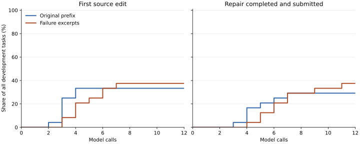

# 038 · 失败摘录独立复验

旧格式完成 **7／24**，摘录组完成 **9／24**。新增 2 道，退步 0 道，净变化 **+2 道**（+8.3 个百分点）。未达到预定的独立复验门槛。

| 指标 | 旧格式 | 失败摘录 |
|---|---:|---:|
| 预算内修复并提交 | 7 | 9 |
| 全程未改源码 | 16 | 15 |
| 预算内修复但未提交 | 0 | 0 |
| 模型调用 | 237 | 240 |
| 输入 token | 876,762 | 804,376 |
| 生成 token | 17,636 | 20,776 |
| 找回回执的生成超时 | 0 | 0 |

| 仓库家族 | 配对 | 新增完成 | 退步 | 净增 |
|---|---:|---:|---:|---:|
| jd/tenacity | 6 | 0 | 0 | +0 |
| moment/luxon | 6 | 1 | 0 | +1 |
| python-babel/babel | 6 | 1 | 0 | +1 |
| simple-statistics/simple-statistics | 6 | 0 | 0 | +0 |

| 预先记录的子组 | 配对 | 旧格式完成 | 摘录组完成 |
|---|---:|---:|---:|
| 旧格式输出被截断 | 18 | 5 | 6 |
| 摘录找回旧格式缺失的完整失败行 | 6 | 2 | 3 |
| 两臂使用同一旧格式 | 6 | 1 | 1 |

从未改码转为改码 2 道，反向变化 1 道。首轮输入由 29,184 降至 20,380 token，少 30.2%。整题输入变化 -8.3%，生成 token 变化 +17.8%。

北京时间 2026-11-20 20:41:40 至 2026-11-20 21:41:33，耗时 59.88 分钟。477 次生成通过回执审计，GPU 共采样 713 条，错误 0 条，峰值显存 61,253 MiB，最高温度 68 °C。

每个仓库家族只做一次双臂运行。这里的独立性基于本项目已知训练与开发来源，底座预训练语料无从核实。评分用隔离副本重跑同一公开回归测试，结果适用于这四组短任务。摘录同时改变输入内容、顺序与长度。本轮零参数更新，发布验收未开启。

[逐题配对](matched-rollouts.csv) · [曲线数值](call-curves.csv) · [完整审计汇总](measurements.json)
