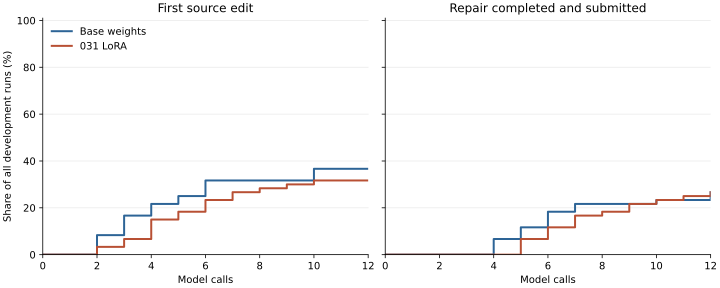

# 039 · 27B 参数独立开发筛查

底座修复并提交 **48/180**，031 LoRA **48/180**。净变化 **+0.00 个百分点**，家族与任务的配对 95% bootstrap 区间为 [-6.67, +6.67]。开发门槛**未通过**。

按每道题三轮的完成次数比较，LoRA 在 1 道题上提高，在 1 道题上下降。

| 指标 | 底座 | 031 LoRA |
|---|---:|---:|
| 全程未编辑 | 114 | 123 |
| 修对未提交 | 9 | 3 |
| 调用数 | 1,893 | 1,938 |
| 输入 token | 6,961,522 | 7,091,578 |
| 生成 token | 159,228 | 134,945 |
| 取回回执的超时 | 0 | 0 |
| 任务执行累计秒数 | 14,644.48 | 22,457.73 |

| 家族 | 净变化（百分点） |
|---|---:|
| acornjs/acorn | +0.00 |
| agronholm/apscheduler | +0.00 |
| date-fns/date-fns | +0.00 |
| hynek/structlog | -10.00 |
| josdejong/mathjs | +0.00 |
| textualize/rich | +10.00 |

| 开发门槛 | 结果 |
|---|---:|
| 完整审计 | 满足 |
| 提高至少 10 个百分点 | 未满足 |
| 区间下界大于零 | 未满足 |
| 单家族下降至多 10 个百分点 | 满足 |

北京时间 2026-11-20 22:43:45 至 2026-11-21 12:13:39。包含 23 次加载，按评测窗口和可见采样估算单卡占用 10.71 小时。3,831 次生成请求通过回执审计。

保留首段 10 次评测，随后续跑 350 次。曾在首个候选生成前中断，排除等待恢复的 19.2 分钟。

工作站重启时已完成 227 次，恢复后完成其余 133 次。从最后一条重启前样本到恢复开始间隔 148.3 分钟。受中断题额外收到 6 条完成回执，已知消耗 14,812 输入和 328 生成 token，1 条响应成本未知。这次中断的生成开销单列，配对只计完整执行。重启前未写入文件的采样错误计数未知。

范围为六个仓库家族的 60 道历史功能修复。每题重复三次，配对区间保留题目内的重复关联。保护评分器在独立副本重跑原公开测试。预训练去污染、长任务和公开参数验收需要独立证据。

[匿名逐次结果](matched-repeats.csv) · [曲线数值](call-curves.csv) · [测量与审计](measurements.json)
