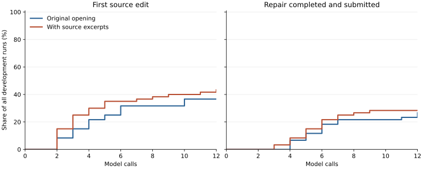

# 040 · 开场源码与首次改码

原开场修复并提交 **16/60**，附源码 **17/60**。净变化 **+1.67 个百分点**，95% 配对 bootstrap 区间为 [-6.67, +11.67]。独立复验门槛**未通过**。

| 指标 | 原开场 | 附源码 |
| --- | ---: | ---: |
| 有实际修改 | 22 | 26 |
| 全程未编辑 | 38 | 34 |
| 修对未提交 | 3 | 5 |
| 调用数 | 632 | 609 |
| 输入 token | 2,327,268 | 2,717,419 |
| 生成 token | 53,536 | 51,863 |
| 任务执行累计秒数 | 4,971.77 | 4,945.83 |

| 家族 | 净变化（百分点） |
|---|---:|
| acornjs/acorn | -10.00 |
| agronholm/apscheduler | +10.00 |
| date-fns/date-fns | +10.00 |
| hynek/structlog | +0.00 |
| josdejong/mathjs | +0.00 |
| textualize/rich | +0.00 |

北京时间 2026-11-21 12:39:59 至 2026-11-21 15:27:58。从加载到退出用时 2.80 小时，1,241 次生成请求通过审计。

两组使用同一 27B 底座和 60 道既有开发题。此次结果用于选择下一轮待独立复验的推理流程。最终测试集封存。

[匿名逐题结果](matched-tasks.csv) · [曲线数值](call-curves.csv) · [审计结果](measurements.json)
