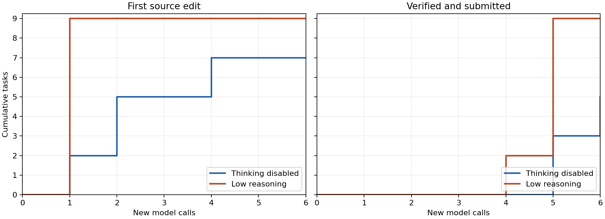

# 041 · 首次改码接续的配对结果

北京时间 2026-11-21 15:29:12 至 2026-11-21 15:59:52。预注册 9 对，完整审计 9 对。全体审计通过的分支共 18 个，核对了 91 条生成回执。

| 完整配对内指标 | 关闭思考 | 低档思考 |
|---|---:|---:|
| 首次实际改码 | 7 | 9 |
| 独立评分通过 | 6 | 9 |
| 预算内验证并提交 | 5 | 9 |
| 合格示范 | 5 | 9 |
| 实际新调用 | 48 | 43 |
| 生成 token，含思考 | 10769 | 8852 |
| 输入 token | 201088 | 168086 |
| 代理累计秒数 | 933.436 | 752.408 |
| 已取回超时回执 | 0 | 0 |

低档思考组在合格示范上新增 4 题、减少 0 题，净变化 +4 题。合格示范覆盖 **9 道题、5 个家族**，采集门槛**通过**。

曲线和两组对照使用完整审计的配对。表中时间为代理累计耗时，历史前缀的成本另计。全部注册配对和未完整审计的分支保留在匿名表中。选题来自已观察的训练失败，结果用于判断能否采集首次改码示范。开发及最终验收另行执行。

[匿名配对 CSV](pairs.csv) · [聚合指标](summary.json) · [硬件统计](hardware.json) · [测量回执](measurements.json) · [冻结设计](../../design.json)
