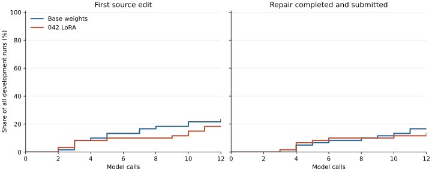

# 042 · 独立开发对照

底座完成 **30/180**，042 LoRA 完成 **24/180**。净变化 **-3.33 个百分点**，配对 95% 区间为 [-15.00, +8.33]。开发门槛**未通过**。

六个独立仓库家族的 60 道题各执行三轮。每组每题最多 12 次调用、6,144 个生成 token，实际改码后通过独立评分并在预算内提交才计为成功。

| 指标 | 底座 | 042 LoRA |
|---|---:|---:|
| 全程未改码 | 138 | 147 |
| 修对未提交 | 6 | 9 |
| 调用数 | 2,016 | 2,016 |
| 输入 token | 7,096,989 | 7,133,622 |
| 生成 token | 136,668 | 117,675 |

北京时间 2026-11-21 16:52:17 至 2026-11-22 02:30:45。流水线历时 9.64 小时，完成配对中的 4,032 条生成请求已逐条核对。

完整配对累计生成用时 8.84 小时，独立评分与收尾共 2.1 分钟。已就绪后端累计加载 25.7 分钟。

GPU 记录 6,882 个样本，各次执行的首末采样跨度合计 9.64 小时。采样平均利用率 42.6%，平均功耗 249 W，峰值显存 67759 MiB，最高温度 64 °C。

[匿名逐次结果](matched-repeats.csv) · [曲线数值](call-curves.csv) · [门槛和区间](summary.json) · [开发登记](../../development-registration.json)
