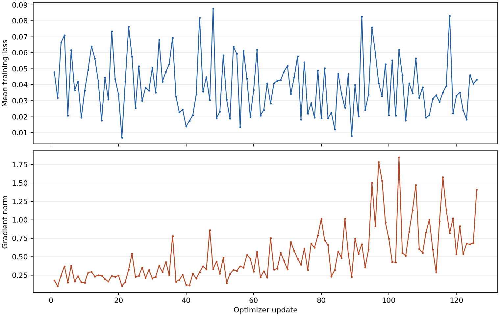

# 042 · 首次改码示范微调结果

北京时间 2026-11-21 16:04:29 至 2026-11-21 16:47:01。单卡训练流水线用时 2551.94 秒。训练产物审计**通过**。

完成 126/126 次优化器更新，已计入 1,033 条动作、2,465,490 个输入 token 和 66,440 个监督 token。

训练循环用时 2399.28 秒。

保存后重载的贪心生成 ID 一致。

采集 506 条 GPU 样本，采样失败 0 次。采样最高显存占用 94,585 MiB，最高温度 70 °C，最长采样间隔 5.26 秒。

每个损失点是该次更新内各动作损失的均值。编码修复成功率由独立开发对照另行评估。

[更新指标](updates.csv) · [测量和硬件回执](measurements.json) · [训练登记](../../registration.json)
