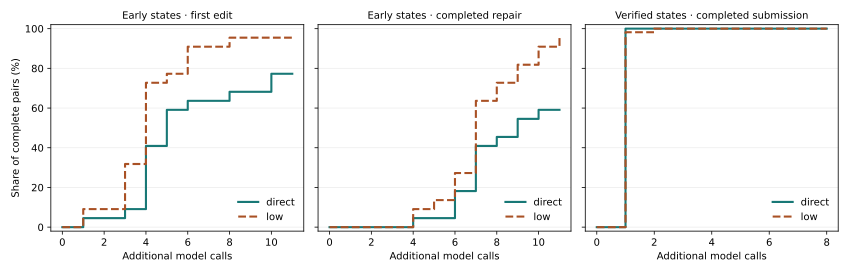

# 043 · 决策状态配对采集

共核对 **133/133** 组完整配对，逐条校验了 **570** 条生成回执。两组从相同源码和可见历史继续，得分要求独立评分通过、验证最终源码并在预算内提交。

| 起始状态 | 完整配对 | 关闭思考完成 | 低档思考完成 | 满足规则的动作分叉 |
|---|---:|---:|---:|---:|
| 首次改码前 | 22 | 13 | 21 | 0 |
| 正确补丁已通过回归 | 111 | 111 | 111 | 0 |

首次改码前，关闭思考有 17 组开始改码，低档思考有 21 组。已验证且只剩一到两次调用的 21 组中，两种模式分别完成 21 和 21 组提交。

有 6 组的分叉动作未直接写出最终验证正确的补丁，另有 2 组未找到同时满足可见历史、源码、剩余预算及执行记录的分叉。这些配对保留在完成率统计中。

首次改码前，关闭思考与低档思考的累计任务用时分别为 38.8 和 51.7 分钟。在正确补丁已通过回归的状态，两种模式分别用时 5.9 和 9.8 分钟。

北京时间 2026-11-22 03:12:12 开始，2026-11-22 05:02:46 结束，单卡流程用时 1.84 小时。

GPU 记录 1,316 个样本。平均利用率 50.7%，平均功耗 281 W，峰值显存 57.4 GiB，最高温度 62 °C。记录到 0 次采样错误。

本轮衡量已见训练状态上的动作选择，独立开发和最终测试有各自的门槛。

[匿名配对结果](pairs.csv) · [曲线数据](call-curves.csv) · [审计摘要](summary.json) · [实验登记](../../design.json)
