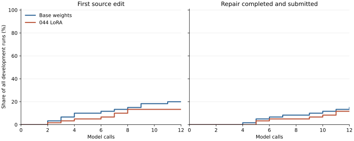

# 044 · 独立开发对照

底座完成 **27/180**，044 LoRA 完成 **21/180**。净变化 **-3.33 个百分点**，配对 95% 区间为 [-10.00, +0.00]。开发门槛**未通过**。

六个独立仓库家族的 60 道题各执行三轮。每组每题最多 12 次调用、6,144 个生成 token，实际改码后通过独立评分并在预算内提交才计为成功。

| 指标 | 底座 | 044 LoRA |
|---|---:|---:|
| 全程未改码 | 144 | 156 |
| 修对未提交 | 3 | 0 |
| 调用数 | 2,043 | 2,079 |
| 输入 token | 7,552,439 | 7,654,575 |
| 生成 token | 169,707 | 141,147 |

北京时间 2026-11-22 06:30:02 至 2026-11-22 17:59:04。流水线历时 11.48 小时，完成配对中的 4,122 条生成请求已逐条核对。

完整配对累计生成用时 10.63 小时，独立评分与收尾共 1.6 分钟。已就绪后端累计加载 25.9 分钟。

GPU 记录 8,197 个样本，各次执行的首末采样跨度合计 11.48 小时。采样平均利用率 42.3%，平均功耗 246 W，峰值显存 66171 MiB，最高温度 65 °C。

[匿名逐次结果](matched-repeats.csv) · [曲线数值](call-curves.csv) · [门槛和区间](summary.json) · [开发登记](../../development-registration.json)
