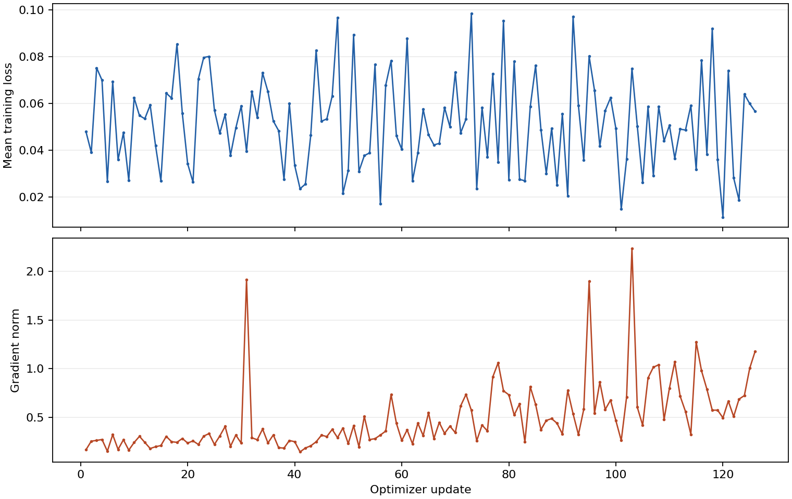

# 044 · 重放完整修复轨迹后微调结果

北京时间 2026-11-22 05:37:41 至 2026-11-22 06:22:56。单卡训练流水线用时 2714.82 秒。训练产物审计**通过**。

完成 126/126 次优化器更新，已计入 1,116 条动作、2,654,652 个输入 token 和 72,051 个监督 token。

训练循环用时 2564.00 秒。

保存后重载的贪心生成 ID 一致。

采集 538 条 GPU 样本，采样失败 0 次。采样最高显存占用 94,583 MiB，最高温度 71 °C，最长采样间隔 5.31 秒。

每个损失点是该次更新内各动作损失的均值。编码修复成功率由独立开发对照另行评估。

[更新指标](updates.csv) · [测量和硬件回执](measurements.json) · [训练登记](../../registration.json)
