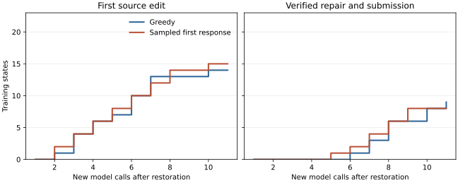

# 045 · 同一状态分叉的首次动作采集

在 22 个配对训练状态上，贪心组修对并提交 **9** 次，首步采样组 **8** 次。共得到 **5** 组满足条件的偏好样本。

北京时间 2026-11-22 18:49:22 至 2026-11-22 19:45:21。审计覆盖 44 次执行和 431 条生成请求。

两组都完成 6 个状态，都未完成 11 个。贪心组独自完成 3 个，首步采样组独自完成 2 个。

| 指标 | 贪心 | 首步采样 |
|---|---:|---:|
| 全程未改码 | 8 | 7 |
| 新调用数 | 218 | 213 |
| 新生成 token | 16,210 | 19,607 |

记录 666 个 GPU 样本，首末采样跨度 55.9 分钟。平均利用率 51.5%，平均功耗 284 W，峰值显存 61893 MiB。

两组从相同的原始源码和可见反馈出发，首步之后共用贪心解码。计数反映训练样本采集，独立开发集用于检验后续训练后的模型。

[匿名逐次数据](matched-actions.csv) · [配对统计](summary.json) · [冻结登记](../../registration.json)
