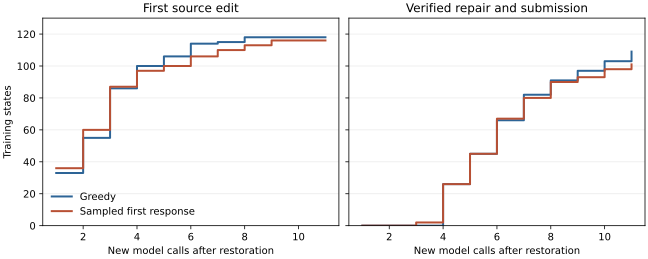

# 047 · 扩大同一状态的首次动作配对

在 129 对训练状态上，贪心组修对并提交 **109** 次，首步采样组 **101** 次。得到 **16** 对可用偏好样本。

两组都成功 97 对，都失败 16 对。贪心组单独成功 12 对，首步采样组单独成功 4 对。

北京时间 2026-11-22 20:27:18 至 2026-11-22 23:51:45。6 批完成审计，共核对 258 次执行和 1822 条请求。

| 指标 | 贪心 | 首步采样 |
|---|---:|---:|
| 全程未改码 | 11 | 13 |
| 新调用数 | 909 | 913 |
| 新生成 token | 62,272 | 66,395 |

各批 GPU 流程合计 3.39 小时。硬件采样 2,426 条，失败 0 次，批内最长采样间隔 5.28 秒。
平均利用率 49.5%，平均功耗 280 W，峰值显存 63353 MiB，最高温度 63 °C。

本轮比较训练状态上两种采集方式。候选模型的质量由后续同预算的独立开发对照验证。

[匿名逐次数据](matched-actions.csv) · [分批及硬件记录](measurements.json) · [配对统计](summary.json) · [预登记](../../registration.json)
