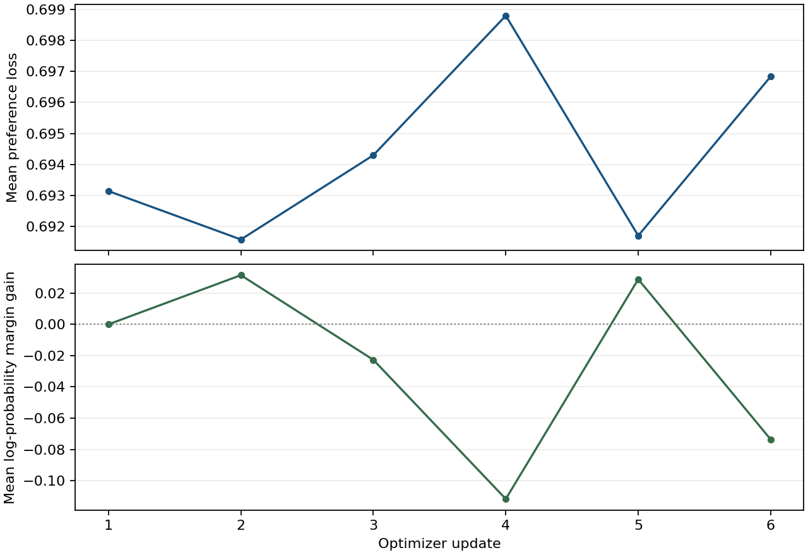

# 048 · 首次动作偏好训练

LoRA 完成 **6 次已审计更新**，共使用 **21 对**样本。其中 045 提供 5 对，047 提供 16 对。

可训练参数为 58,363,904 个。重载适配器后的固定输入生成和动作分数均通过核对。

最后一次训练尝试为北京时间 2026-11-23 00:00:41 至 2026-11-23 00:03:49。共记录 1 次训练尝试，1 次具有可核对的硬件采样记录，合计 37 条采样，0 次采样错误。
采样峰值显存 56,921 MiB，最高温度 65 °C。

曲线显示训练样本上的偏好损失，以及相对底座的偏好边际变化。模型效果由独立开发对照测量。

[逐步统计](updates.csv) · [核验记录](measurements.json) · [训练登记](../../registration.json)
