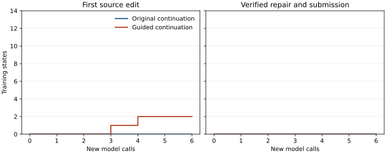

# 049 · 已查阅源码后的修复接续

在 13 个配对训练状态上，原续跑修对并提交 **0** 次，提示组 **0** 次。提示独胜 0 次，原续跑独胜 0 次。采集扩大门槛**未通过**。

0 条完整轨迹符合训练数据准入规则，覆盖 0 个训练仓库家族，保留 0 个编辑、验证或提交动作。

北京时间 2026-11-23 10:53:24 至 2026-11-23 11:17:43，共审计 26 次执行和 156 条生成请求。

| 指标 | 原续跑 | 提示组 |
| --- | ---: | ---: |
| 全程未改码 | 13 | 11 |
| 通过独立评分 | 0 | 2 |
| 新调用数 | 78 | 78 |
| 新生成 token | 7,597 | 7,357 |

GPU 采样 290 条，平均利用率 50.0%，平均功耗 275 W，峰值显存 57467 MiB。

本轮测量经过筛选的训练状态上的采集效果。模型发布继续按独立开发与最终测试验收。

[匿名逐次结果](matched-runs.csv) · [曲线数据](call-curves.csv) · [冻结登记](../../registration.json)
