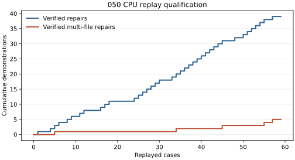

# 050 · 历史修复示范重放结果

共重放 **59** 条，**39** 条通过回归、提交、独立评分和输入重建。合格示范覆盖 4 个家族，其中 5 条来自 4 个家族的必要多文件修复。数据门槛**未通过**。

共保留 **160** 个动作和 **33,942** 个受监督 token。北京时间 14:06:52 至 14:12:07 在 CPU 上执行，用时 314 秒。

| 动作 | 数量 |
| --- | ---: |
| 源码编辑 | 82 |
| 独立回归 | 39 |
| 显式提交 | 39 |

有 20 条在动作规划时遇到单个参考补丁片段超出 512 token 上限，实际源码编辑调用数为 0。

完整计数、淘汰原因和覆盖门槛见 [summary.json](summary.json)。匿名逐题测量见 [measurements.json](measurements.json)。

这里衡量的是参考修复示范能否重放。模型训练和部署效果分别验收，最终测试集继续封存。
