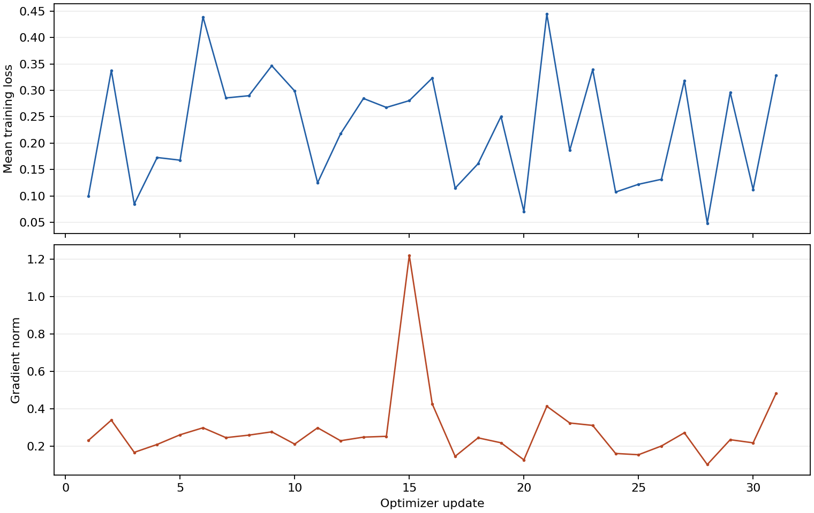

# 051 · 验证修复动作微调结果

完成 **31** 次更新，消耗 **243** 条动作和 **55,299** 个监督 token。LoRA 可训练参数 58,363,904，底座保持冻结，保存后重新加载的贪心输出一致。训练产物通过独立审计。

北京时间 2026-11-23 15:31:46 至 2026-11-23 15:44:27，单卡流水线用时 762 秒，训练循环用时 636 秒。

GPU 采样 151 条，失败 0 次。平均利用率 81.2%，峰值显存 94,997 MiB，最高温度 71 °C。

每个损失点为对应更新内的动作损失均值，修复成功率由待运行的独立开发对照验收。

[逐次更新](updates.csv) · [测量与硬件回执](measurements.json) · [训练登记](../../registration.json)
