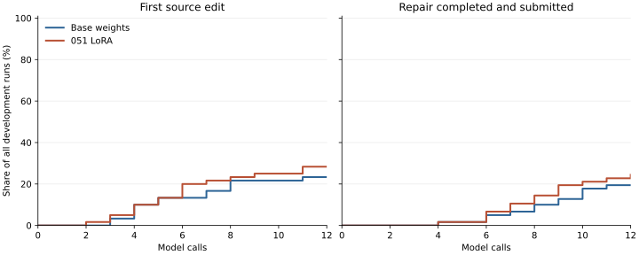

# 051 · 独立开发对照

底座完成 **35/180**，051 LoRA 完成 **44/180**。净变化 **+5.00 个百分点**，配对 95% 区间为 [-6.11, +16.67]。开发门槛**未通过**。

六个独立仓库家族的 60 道题各执行三轮。每组每题最多 12 次调用、6,144 个生成 token，实际改码后通过独立评分并在预算内提交才计为成功。

| 指标 | 底座 | 051 LoRA |
|---|---:|---:|
| 全程未改码 | 138 | 129 |
| 修对未提交 | 3 | 6 |
| 调用数 | 2,025 | 1,980 |
| 输入 token | 7,431,316 | 7,226,331 |
| 生成 token | 136,282 | 128,574 |

北京时间 2026-11-23 18:07:27 至 2026-11-24 04:04:56。流水线历时 9.96 小时，完成配对中的 4,005 条生成请求已逐条核对。

完整配对累计生成用时 9.35 小时，独立评分与收尾共 2.6 分钟。已就绪后端累计加载 12.5 分钟。

GPU 记录 7,109 个样本，各次执行的首末采样跨度合计 9.96 小时。采样平均利用率 43.0%，平均功耗 246 W，峰值显存 65371 MiB，最高温度 64 °C。

[匿名逐次结果](matched-repeats.csv) · [曲线数值](call-curves.csv) · [门槛和区间](summary.json) · [开发登记](../../development-registration.json)
