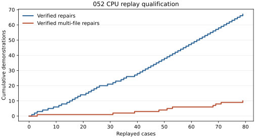

# 052 · 历史修复示范重放结果

共重放 **79** 条，**67** 条通过回归、提交、独立评分和输入重建。合格示范覆盖 7 个家族，其中 10 条来自 4 个家族的必要多文件修复。数据门槛**通过**。

共保留 **287** 个动作和 **58,465** 个受监督 token。北京时间 04:35:35 至 04:58:53 在 CPU 上执行，用时 1399 秒。

| 动作 | 数量 |
| --- | ---: |
| 源码编辑 | 153 |
| 独立回归 | 67 |
| 显式提交 | 67 |

完整计数、淘汰原因和覆盖门槛见 [summary.json](summary.json)。匿名逐题测量见 [measurements.json](measurements.json)。

这里衡量的是参考修复示范能否重放。模型训练和部署效果分别验收，最终测试集继续封存。
