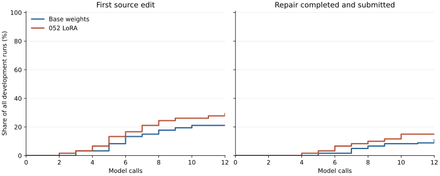

# 052 · 独立开发对照

底座完成 **20/180**，052 LoRA 完成 **27/180**。净变化 **+3.89 个百分点**，配对 95% 区间为 [-3.33, +11.67]。开发门槛**未通过**。

六个独立仓库家族的 60 道题各执行三轮。每组每题最多 12 次调用、6,144 个生成 token，实际改码后通过独立评分并在预算内提交才计为成功。

| 指标 | 底座 | 052 LoRA |
|---|---:|---:|
| 全程未改码 | 142 | 127 |
| 修对未提交 | 11 | 5 |
| 调用数 | 2,087 | 2,031 |
| 输入 token | 8,520,284 | 8,274,428 |
| 生成 token | 133,125 | 129,525 |

北京时间 2026-11-24 06:40:07 至 2026-11-24 16:50:59。流水线历时 10.18 小时，完成配对中的 4,118 条生成请求已逐条核对。

完整配对累计生成用时 9.50 小时，独立评分与收尾共 1.9 分钟。已就绪后端累计加载 11.1 分钟。

GPU 记录 7,268 个样本，各次执行的首末采样跨度合计 10.18 小时。采样平均利用率 43.7%，平均功耗 249 W，峰值显存 66101 MiB，最高温度 65 °C。

[匿名逐次结果](matched-repeats.csv) · [曲线数值](call-curves.csv) · [门槛和区间](summary.json) · [开发登记](../../development-registration.json)
