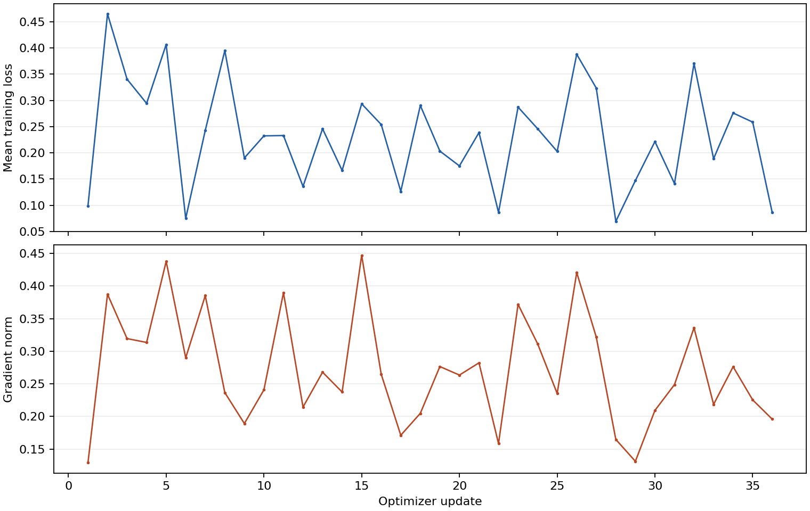

# 052 · 源码证据微调结果

完成 **36** 次更新，共用 **287** 个动作和 **58,465** 个监督 token。LoRA 可训练参数 58,363,904，保存后重载的贪心生成 ID 一致。训练产物通过独立审计。

北京时间 2026-11-24 05:12:08 至 2026-11-24 05:25:26。单卡流水线用时 798 秒，训练循环用时 721 秒。

GPU 采样 158 条，失败 0 次。平均利用率 89.2%，峰值显存 92,107 MiB，最高温度 71 °C。

各点对应一次优化器更新。代码修复成功率由独立开发任务验收。

[逐次更新](updates.csv) · [测量与硬件回执](measurements.json) · [训练登记](../../training-registration.json)
