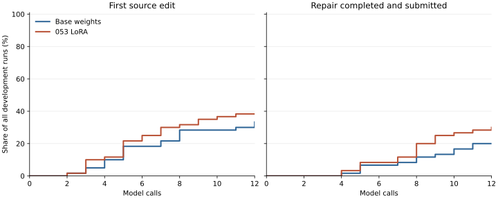

# 053 · 独立开发对照

底座完成 **36/180**，053 LoRA 完成 **54/180**。净变化 **+10.00 个百分点**，配对 95% 区间为 [-1.67, +23.33]。开发门槛**未通过**。

六个独立仓库家族的 60 道题各执行三轮。每组每题最多 12 次调用、6,144 个生成 token，实际改码后通过独立评分并在预算内提交才计为成功。

| 指标 | 底座 | 053 LoRA |
|---|---:|---:|
| 全程未改码 | 120 | 111 |
| 修对未提交 | 6 | 0 |
| 调用数 | 1,998 | 1,923 |
| 输入 token | 6,806,799 | 6,589,176 |
| 生成 token | 165,090 | 160,638 |

北京时间 2026-11-25 02:22:48 至 2026-11-25 14:08:00。流水线历时 11.75 小时，完成配对中的 3,921 条生成请求已逐条核对。

完整配对累计生成用时 11.21 小时，独立评分与收尾共 3.3 分钟。已就绪后端累计加载 10.2 分钟。

GPU 记录 8,391 个样本，各次执行的首末采样跨度合计 11.75 小时。采样平均利用率 42.0%，平均功耗 244 W，峰值显存 63863 MiB，最高温度 67 °C。

[匿名逐次结果](matched-repeats.csv) · [曲线数值](call-curves.csv) · [门槛和区间](summary.json) · [开发登记](../../development-registration.json)
