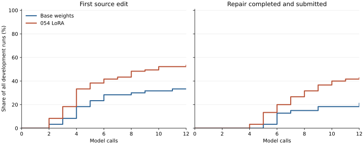

# 054 · 独立开发对照

底座完成 **38/180**，054 LoRA 完成 **77/180**。净变化 **+21.67 个百分点**，配对 95% 区间为 [+6.67, +38.33]。开发门槛**通过**。

六个独立仓库家族的 60 道题各执行三轮。每组每题最多 12 次调用、6,144 个生成 token，实际改码后通过独立评分并在预算内提交才计为成功。

| 指标 | 底座 | 054 LoRA |
|---|---:|---:|
| 全程未改码 | 120 | 84 |
| 修对未提交 | 9 | 3 |
| 调用数 | 1,978 | 1,770 |
| 输入 token | 7,217,230 | 5,923,742 |
| 生成 token | 187,852 | 178,158 |

### 按修复范围拆分

| 修复范围 | 题数 | 底座修对并提交 | 054 LoRA 修对并提交 |
|---|---:|---:|---:|
| 单文件 | 49 | 38/147 | 77/147 |
| 多文件 | 11 | 0/33 | 0/33 |

北京时间 2026-11-25 19:45:20 至 2026-11-26 10:52:47。流水线历时 15.12 小时，完成配对中的 3,748 条生成请求已逐条核对。

完整配对累计生成用时 12.41 小时，独立评分与收尾共 2.8 分钟。已就绪后端累计加载 12.5 分钟。

GPU 记录 9,323 个样本，各次执行的首末采样跨度合计 13.06 小时。采样平均利用率 41.2%，平均功耗 241 W，峰值显存 68067 MiB，最高温度 66 °C。

第 1 次执行的采样文件在重启时留下 61 字节的零填充尾部。统计使用此前的完整采样行，已审计的原始文件保留。

工作站重启 1 次。中断分支中的 6 条请求单独记账，已知消耗 7,612 个输入 token 和 624 个生成 token，另有 1 条请求的消耗未知。

[匿名逐次结果](matched-repeats.csv) · [曲线数值](call-curves.csv) · [门槛和区间](summary.json) · [开发登记](../../development-registration.json)
