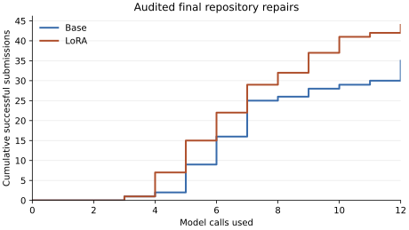

# 054 · 独立最终验收

最终质量门槛**未通过**。

| 最终测试 | 配对数 | 底座通过 | LoRA 通过 | 新增成功 | 退步 |
|---|---:|---:|---:|---:|---:|
| 新留出 | 24 | 10 | 14 | 6 | 2 |
| 历史回归 | 48 | 25 | 30 | 6 | 1 |

函数回归共 9 道，底座通过 9 道，LoRA 通过 9 道。

北京时间 2026-11-26 11:48:06 至 2026-11-26 15:30:35。单卡评测用时 3.71 小时，离线回放核验 1,318 条仓库任务请求。

曲线合计新留出和历史回归任务，按成功提交时实际消耗的模型调用数累计。

评测期间取得 2,648 条 GPU 样本，采样失败 0 次。观测峰值显存 63,087 MiB，最高温度 67 °C，GPU 利用率样本均值 41.0%。采样覆盖加载、推理和工具等待。

未通过的质量检查为 `fresh_regressions`、`historical_regressions`。

[聚合计分与门槛](summary.json) · [已审计的开发结果](https://github.com/CaptainGreenskin/one-gpu-lm/tree/f96fa374a2ea6fe9770e8095b352fb5b249a6333/experiments/054-expanded-repair-sft/results/2026-11-26-development) · [最终验收规则](../../../022-action-repair/protocol.json)
