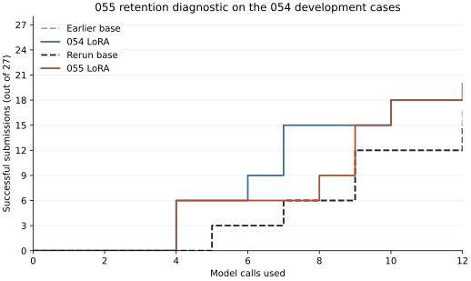

# 055 · 底座能力保留诊断

9 道旧开发题各复跑三轮。复跑底座和 055 使用相同的工具、调用与 token 预算。

| 任务组 | 配对 | 原底座 | 054 | 复跑底座 | 055 | 复跑新增 | 复跑退步 |
|---|---:|---:|---:|---:|---:|---:|---:|
| 054 曾退步 | 9 | 8 | 2 | 6 | 6 | 3 | 3 |
| 054 稳定增益 | 9 | 0 | 9 | 0 | 6 | 6 | 0 |
| 底座与 054 均通过 | 9 | 9 | 9 | 9 | 6 | 0 | 3 |

055 找回原来 054 退步的 5／6 个配对，保留原来 054 新增成功的 6／9 个配对。

北京时间 2026-11-26 16:22:50 至 2026-11-26 18:15:15。复跑单卡流水线用时 1.87 小时，审计核验 510 条请求。

以上用于追踪已知退步与增益的复现。晋级由独立的六家族开发对照决定。

[匿名汇总](summary.json) · [诊断登记](../../diagnostic-registration.json)
