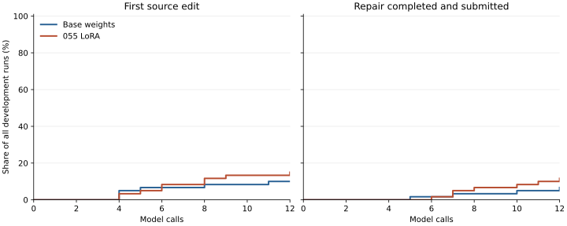

# 055 · 独立开发对照

底座完成 **12/180**，055 LoRA 完成 **21/180**。净变化 **+5.00 个百分点**，配对 95% 区间为 [-5.00, +16.67]。开发门槛**未通过**。

六个独立仓库家族的 60 道题各执行三轮。每组每题最多 12 次调用、6,144 个生成 token，实际改码后通过独立评分并在预算内提交才计为成功。

| 指标 | 底座 | 055 LoRA |
|---|---:|---:|
| 全程未改码 | 162 | 153 |
| 修对未提交 | 3 | 3 |
| 调用数 | 2,118 | 2,091 |
| 输入 token | 7,473,264 | 7,293,316 |
| 生成 token | 131,678 | 138,270 |

### 按修复范围拆分

| 修复范围 | 题数 | 底座修对并提交 | 055 LoRA 修对并提交 |
|---|---:|---:|---:|
| 单文件 | 44 | 9/132 | 18/132 |
| 多文件 | 16 | 3/48 | 3/48 |

北京时间 2026-11-26 18:59:11 至 2026-11-27 05:10:17。流水线历时 10.18 小时，完成配对中的 4,209 条生成请求已逐条核对。

完整配对累计生成用时 9.57 小时，独立评分与收尾共 1.0 分钟。已就绪后端累计加载 11.5 分钟。

GPU 记录 7,271 个样本，各次执行的首末采样跨度合计 10.18 小时。采样平均利用率 42.4%，平均功耗 248 W，峰值显存 67051 MiB，最高温度 69 °C。

[匿名逐次结果](matched-repeats.csv) · [曲线数值](call-curves.csv) · [门槛和区间](summary.json) · [开发登记](../../development-registration.json)
