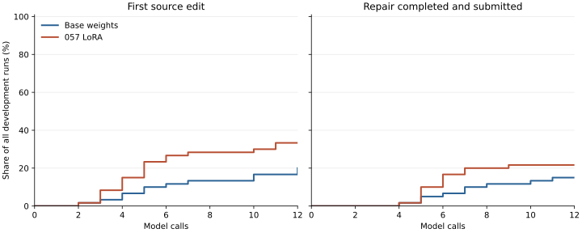

# 057 · 独立开发对照

底座完成 **27/180**，057 LoRA 完成 **39/180**。净变化 **+6.67 个百分点**，配对 95% 区间为 [+0.00, +16.67]。开发门槛**未通过**。

六个独立仓库家族的 60 道题各执行三轮。每组每题最多 12 次调用、6,144 个生成 token，实际改码后通过独立评分并在预算内提交才计为成功。

| 指标 | 底座 | 057 LoRA |
|---|---:|---:|
| 全程未改码 | 144 | 120 |
| 修对未提交 | 6 | 9 |
| 调用数 | 2,025 | 1,920 |
| 输入 token | 7,024,495 | 6,642,310 |
| 生成 token | 129,640 | 137,574 |

### 按修复范围拆分

| 修复范围 | 题数 | 底座修对并提交 | 057 LoRA 修对并提交 |
|---|---:|---:|---:|
| 单文件 | 50 | 27/150 | 39/150 |
| 多文件 | 10 | 0/30 | 0/30 |

北京时间 2026-11-27 12:16:34 至 2026-11-28 02:37:46。流水线历时 14.35 小时，完成配对中的 3,945 条生成请求已逐条核对。

完整配对累计生成用时 9.44 小时，独立评分与收尾共 2.4 分钟。已就绪后端累计加载 15.3 分钟。

GPU 记录 7,163 个样本，各次执行的首末采样跨度合计 10.03 小时。采样平均利用率 42.0%，平均功耗 245 W，峰值显存 66423 MiB，最高温度 69 °C。

工作站重启 1 次。中断分支中的 6 条请求单独记账，已知消耗 6,149 个输入 token 和 246 个生成 token，另有 1 条请求的消耗未知。

[匿名逐次结果](matched-repeats.csv) · [曲线数值](call-curves.csv) · [门槛和区间](summary.json) · [开发登记](../../development-registration.json)
