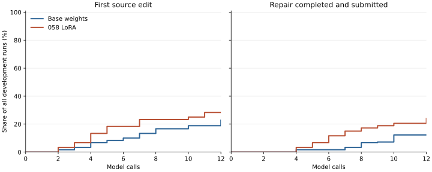

# 058 · 独立开发对照

底座完成 **22/180**，058 LoRA 完成 **43/180**。净变化 **+11.67 个百分点**，配对 95% 区间为 [+1.11, +25.57]。开发门槛**通过**。

六个独立仓库家族的 60 道题各执行三轮。每组每题最多 12 次调用、6,144 个生成 token，实际改码后通过独立评分并在预算内提交才计为成功。

| 指标 | 底座 | 058 LoRA |
|---|---:|---:|
| 全程未改码 | 139 | 129 |
| 修对未提交 | 4 | 3 |
| 调用数 | 2,076 | 1,955 |
| 输入 token | 7,621,635 | 6,999,696 |
| 生成 token | 134,507 | 128,898 |

### 按修复范围拆分

| 修复范围 | 题数 | 底座修对并提交 | 058 LoRA 修对并提交 |
|---|---:|---:|---:|
| 单文件 | 44 | 22/132 | 43/132 |
| 多文件 | 16 | 0/48 | 0/48 |

北京时间 2026-11-28 05:27:57 至 2026-11-28 15:32:25。流水线历时 10.07 小时，完成配对中的 4,031 条生成请求已逐条核对。

完整配对累计生成用时 9.27 小时，独立评分与收尾共 1.6 分钟。已就绪后端累计加载 26.0 分钟。

GPU 记录 7,191 个样本，各次执行的首末采样跨度合计 10.07 小时。采样平均利用率 42.2%，平均功耗 246 W，峰值显存 65863 MiB，最高温度 68 °C。

[匿名逐次结果](matched-repeats.csv) · [曲线数值](call-curves.csv) · [门槛和区间](summary.json) · [开发登记](../../development-registration.json)
