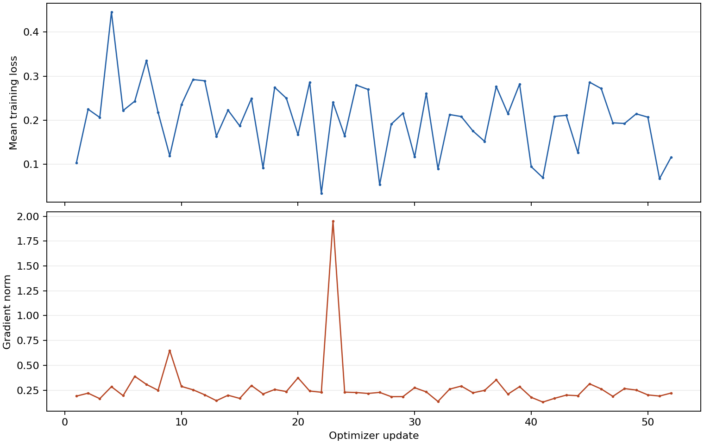

# 058 · 多次查阅上下文训练结果

完成 **52** 次更新，共用 **412** 个动作和 **84,481** 个监督 token。LoRA 可训练参数 58,363,904，保存后重载的贪心生成 ID 一致。训练产物通过独立审计。

北京时间 2026-11-28 03:39:28 至 2026-11-28 04:01:08。单卡流水线用时 1301 秒，训练循环用时 1139 秒。

GPU 采样 258 条，失败 0 次。平均利用率 86.9%，峰值显存 94,753 MiB，最高温度 71 °C。

各点对应一次优化器更新。代码修复成功率由独立开发任务验收。

[逐次更新](updates.csv) · [测量与硬件回执](measurements.json) · [训练登记](../../training-registration.json)
